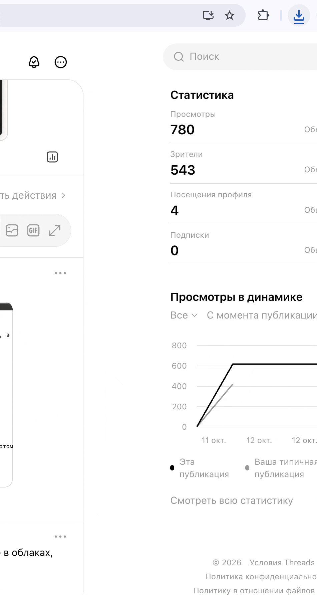
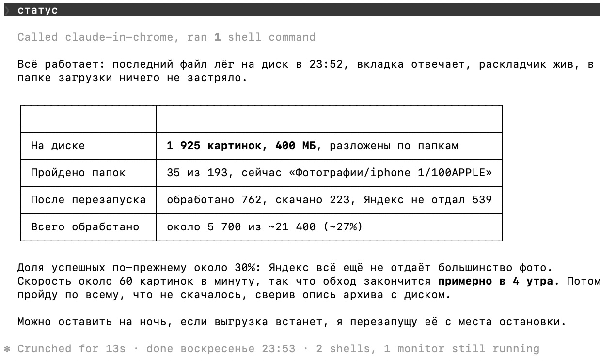
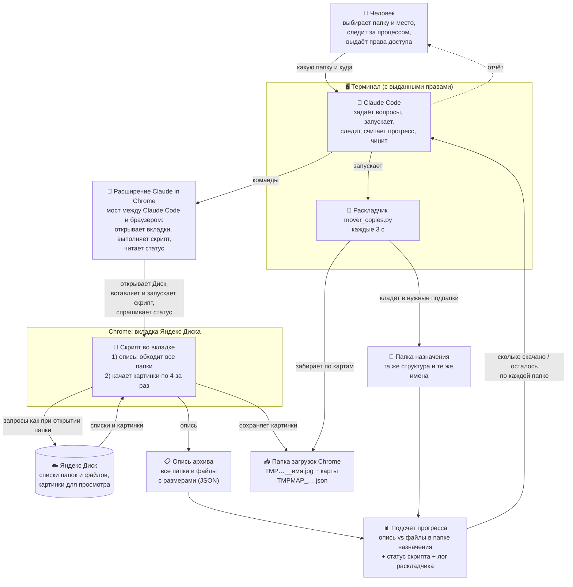

# 📸 Как скачивать картинки с Яндекс Диска через ИИ-агента — бесплатный скилл

🆓 **Бесплатный** скилл для Claude Code `yandex-disk-export`.

☕ **Скилл помог?** Поддержите автора донатом: **[pay.cloudtips.ru/p/03e08907](https://pay.cloudtips.ru/p/03e08907)**


**Массовое скачивание**, а не по одному фото: скилл сам выгружает всю папку Яндекс Диска со всеми подпапками — хоть десятки тысяч фото за раз — в любую папку на компьютере или внешнем диске, без кликов, с сохранением структуры подпапок. Работает через открытую вкладку Яндекс Диска в Chrome, поэтому помогает, даже когда обычное скачивание у Яндекса не работает.

> Скилл сделан во время сбоя Яндекса, когда скачивание с Диска перестало работать. Мы надеемся, что Яндекс скоро всё починит и мы зря переживали за свои фото и видео, но не могли остаться в стороне и рисковать: на Диске хранится память нашей семьи и детства.

> ⚠️ **Отказ от ответственности.** Скилл распространяется «как есть». Мы не несём ответственности за то, как Claude или другой ИИ-агент поведёт себя с этим скиллом, и за любые последствия: потерю, порчу или перезапись файлов, действия в вашем браузере и аккаунтах. Вся ответственность за запуск лежит на вас — следите за тем, что делает агент, и подтверждайте только понятные вам действия.

⚠️ **Важно:** скачиваются версии для просмотра — до 1280px по длинной стороне, без EXIF (даты съёмки/камеры). Видео так не скачиваются. Это страховка, а не замена оригиналам.

## 🎬 Как это выглядит в работе

Пример: Chrome сам скачивает фото одно за другим (временные имена `TMP…`), а раскладчик тут же забирает их и кладёт по папкам под исходными именами.



А так Claude отвечает на вопрос «статус» прямо в терминале: сколько уже на диске, сколько папок пройдено, сколько Яндекс не отдал и когда закончится.



## 🗺️ Как это устроено: кто что делает



| Кто | Что делает |
|---|---|
| 👤 Человек | Говорит, какую папку скачать и куда, следит за процессом и подтверждает действия агента |
| 🤖 Claude Code | Задаёт вопросы, через расширение открывает Диск и запускает скрипт, запускает раскладчик в терминале, считает прогресс, при остановке продолжает с места остановки, присылает отчёт |
| 🧩 Расширение Claude in Chrome | Связывает Claude Code с вашим Chrome: открывает вкладки, выполняет скрипт во вкладке Диска, читает его статус (сколько обработано, что не скачалось) |
| 📜 Скрипт во вкладке | Под вашим логином запрашивает у Яндекса содержимое папок (как сам сайт): сначала делает опись всего архива, потом качает картинки по 4 за раз и сохраняет их с временным именем `TMP…` и картой «код → путь» |
| ☁️ Яндекс Диск | Отдаёт списки папок и картинки в версии для просмотра |
| 📋 Опись архива | Полный список папок и файлов с размерами — знаем заранее, сколько всего картинок и в какой папке |
| 🖥️ Терминал | Здесь работает всё: Claude Code и раскладчик запускаются в Терминале macOS, и им нужны выданные права (см. ниже) |
| 🐍 Раскладчик | Каждые 3 секунды забирает файлы из папки загрузок и по карте кладёт их в нужную подпапку под исходным именем |
| 📊 Подсчёт прогресса | Claude сравнивает опись с тем, что уже лежит в папке назначения: «скачано X из Y» по каждой папке; плюс статус скрипта и лог раскладчика — видно, если что-то встало |

## 🔐 Терминал и права доступа
Всё запускается в **Терминале**: там работает Claude Code, оттуда он управляет Chrome и там же крутится раскладчик. Без выданных прав ничего не заработает — по ходу появятся запросы, их нужно подтвердить:

- **Claude Code** спрашивает разрешение на команды в терминале (запуск раскладчика, работа с файлами) и на действия в браузере — читайте, что именно подтверждаете.
- **macOS → Терминал**: доступ к папкам и **внешнему диску** («Терминал запрашивает доступ к файлам на съёмном томе» → Разрешить). Если запроса не было, а доступа нет: Системные настройки → Конфиденциальность и безопасность → «Файлы и папки» (или «Полный доступ к диску») → включить Терминал.
- **Расширение Claude in Chrome**: разрешить работу на сайте `disk.yandex.ru`.
- **Chrome**: «Разрешить сайту скачивать несколько файлов?» → Разрешить; в настройках загрузок выключить «Всегда указывать место для скачивания».
- **Mac не должен засыпать** — Claude запускает `caffeinate` сам, но крышку ноутбука лучше не закрывать.

## ✨ Что умеет
- 📦 скачивает массово: всю папку целиком, а не каждое фото вручную
- 📂 повторяет структуру папок с Диска один в один
- 🏷️ сохраняет исходные имена файлов
- 🖼️ качает JPG, PNG, GIF, а также превью RAW (CR2) и HEIC
- 💾 сохраняет в любую папку: на Mac, внешний или сетевой диск
- 🔁 запоминает, что не скачалось, и умеет повторить
- ⏯️ продолжает с места остановки, если что-то прервалось

## 🧰 Что нужно
- [Claude Code](https://claude.com/claude-code)
- Расширение **[Claude in Chrome](https://chromewebstore.google.com/detail/claude/fcoeoabgfenejglbffodgkkbkcdhcgfn)** (Chrome Web Store), подключённое к Claude Code (обычно командой `/chrome`, [инструкция](https://code.claude.com/docs/en/chrome))
- Вход в свой Яндекс Диск в Chrome
- Python 3

Без расширения тоже можно — см. раздел «Ручной режим» в [SKILL.md](SKILL.md).

## ⚙️ Установка
```bash
mkdir -p ~/.claude/skills
git clone https://github.com/kochenevsky/yandex-disk-export ~/.claude/skills/yandex-disk-export
```
Перезапустите Claude Code и напишите: «выгрузи папку с Яндекс Диска на диск» или `/yandex-disk-export`.

## 📁 Состав
- `SKILL.md` — инструкция для Claude (шаги, грабли, ручной режим)
- `scripts/browser_preview_export.js` — скрипт для вкладки Яндекс Диска: опись папок и выгрузка
- `scripts/mover_copies.py` — раскладчик: переносит скачанное в нужные подпапки
- `scripts/done_folders.py` — список уже скачанных папок для продолжения после остановки

---

☕ Если скилл сохранил ваши фото — **[поддержите донатом](https://pay.cloudtips.ru/p/03e08907)**. Спасибо!
